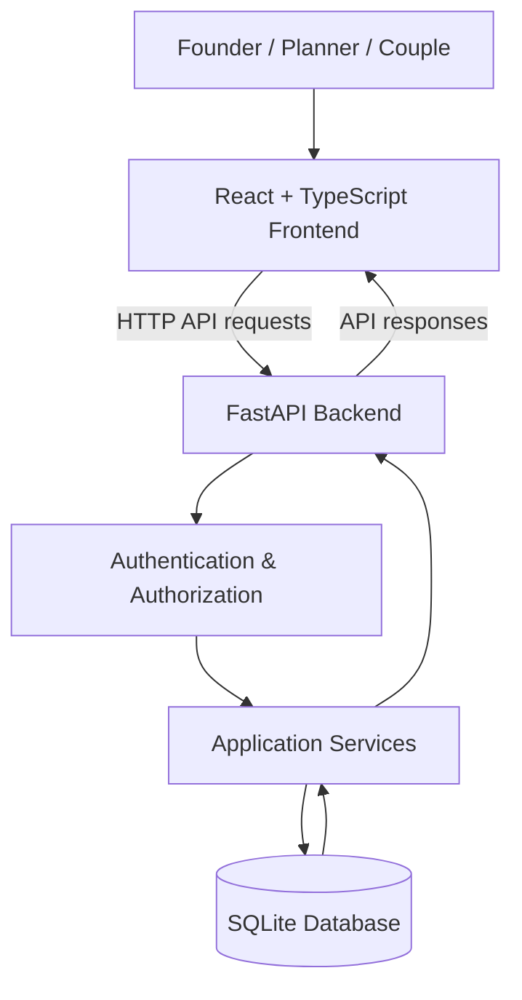

# 💍 EverWed — Wedding Planning Management System

**Plan with clarity. Coordinate with confidence. Celebrate every moment.**

EverWed is a web-based wedding planning management system designed to bring essential wedding planning activities into one organized workspace. It helps couples manage wedding details, planners coordinate assigned weddings, and founders oversee users and wedding operations.

The project focuses on simplifying wedding preparation through structured workflows for events, guests, tasks, budgets, and vendor records.

> Built as a practical full-stack project exploring how technology can make wedding planning more organized and manageable.

## ✨ Project Overview

Planning a wedding involves coordinating multiple activities, including setting dates, organizing ceremonies, maintaining guest lists, tracking tasks, and managing budgets. When information is scattered across different tools, keeping everything organized can become difficult.

EverWed aims to address this challenge with a role-based application that centralizes essential planning information and supports collaboration between couples, planners, and administrators.

### 🎯 Project Goals

- Centralize important wedding planning information.
- Simplify event and ceremony coordination.
- Make guest management and RSVP tracking easier.
- Organize planning tasks and checklists.
- Provide visibility into planned budgets and recorded financial information.
- Separate access according to user roles and wedding ownership.

## 🚀 Features

The following features are described in the current project documentation.

### 👑 Founder / Admin

- Secure login and logout.
- Dashboard displaying information from stored records.
- View weddings and their details.
- Review client enquiries.
- Create Planner and Couple accounts.
- Activate and deactivate user accounts.
- Approve or reject Planner registration requests.
- Assign planners to weddings.
- Edit wedding details, budgets, package fees, and lifecycle status.
- View wedding events, tasks, guests, vendors, and financial summaries.
- Manage basic vendor records.

### 📋 Wedding Planner

- Submit a registration request for Founder approval.
- Log in after account activation.
- View assigned weddings and associated couple details.
- Create, edit, and delete wedding events.
- View and update planning tasks.
- Manage guest records and RSVP statuses.
- Access the vendor directory in read-only mode.

Planner access is restricted to assigned weddings. The Wedding Builder is reserved for Couple accounts.

### 💑 Couple

- Register and securely access an account.
- Access a personalized wedding dashboard.
- Create and edit wedding details through the Wedding Builder.
- Specify wedding traditions, regional customs, and functions.
- Manage wedding information such as dates, location, venue, and planned budget.
- Maintain guest lists and RSVP statuses.
- Search and filter guest records.
- Import guest information through CSV files.
- Manage a persistent wedding planning checklist.
- Review planned budgets, recorded expenses, payments, and remaining balances.
- View the assigned planner when one is available.

### 🗓️ Wedding Planning Workflows

**Wedding Builder**

A guided, eight-step workflow for collecting partner details, wedding dates, traditions, optional regional customs, functions, venue information, guest estimates, and planned budget.

**Events and ceremonies**

Create and maintain event details, including dates, times, and venues.

**Guest coordination**

Maintain guest information, update RSVP statuses, and organize guest records. CSV imports support bulk entry, with duplicate or invalid rows reported and skipped.

**Task management**

Track wedding preparation tasks, mark tasks complete or reopen them, and retain task updates in the database.

**Budget overview**

Review the planned budget alongside recorded expenses and payments. The application should not be treated as a payment gateway or accounting platform.

**Vendor management**

Maintain basic vendor records for wedding service coordination.

## 🧑‍💻 Technology Stack

| Layer | Technology |
|---|---|
| Frontend framework | React |
| Frontend language | TypeScript |
| Frontend build tool | Vite |
| Styling | Tailwind CSS |
| Backend framework | FastAPI |
| Backend language | Python |
| Database | SQLite |
| API communication | HTTP-based frontend-to-backend requests |
| Authentication | Signed, expiring, revocable sessions |
| Password storage | Scrypt password hashing |

The stack above reflects the technologies and security mechanisms described in the repository's existing documentation.

## 🏗️ System Architecture

EverWed follows a frontend–backend architecture in which the web application communicates with a Python API, and the backend works with a persistent SQLite database.



### Architecture responsibilities

- **Frontend:** Provides the user interface, role-specific navigation, and wedding planning workflows.
- **Backend:** Handles API requests, business operations, validation, and access control.
- **Authentication and authorization:** Checks session validity, user roles, and access to wedding records.
- **Database:** Stores application records persistently using SQLite.

The diagram represents the documented architecture at a high level. Consult the backend implementation for the exact service and module boundaries.

## 📁 Project Structure

```text
EverWed/
├── backend/
│   ├── app/                  # Backend application
│   ├── data/                 # Local application database
│   ├── scripts/              # Administrative scripts
│   └── requirements.txt      # Python dependencies
├── frontend/
│   ├── src/                  # React application source
│   ├── package.json          # Frontend scripts and dependencies
│   └── .env.example          # Frontend environment template
├── docs/                     # Project documentation
├── .freebuff/                # Tool-specific project artifacts
├── start.bat                 # Windows startup helper
├── start.ps1                 # PowerShell startup helper
└── README.md                 # Project overview and setup
```

This is a simplified overview. The exact contents of each directory may vary as the project evolves. Tool-specific files should be retained or removed only after their purpose has been checked.

## ⚙️ Prerequisites

The existing setup instructions specify:

- Python 3.10 or later.
- Node.js 20 or later.
- npm.
- Git.
- A terminal such as PowerShell, Command Prompt, or a Unix shell.

## 📦 Installation and Setup

### 1. Clone the repository

```bash
git clone https://github.com/mohd-ibrahim-prog/EverWed.git
cd EverWed
```

### 2. Configure the backend

```bash
cd backend
python -m venv .venv
```

Activate the virtual environment.

**Windows — PowerShell:**

```powershell
.\.venv\Scripts\Activate.ps1
```

**Windows — Command Prompt:**

```bat
.venv\Scripts\activate.bat
```

**macOS / Linux:**

```bash
source .venv/bin/activate
```

Install the Python dependencies:

```bash
python -m pip install -r requirements.txt
```

Create the local environment file from the supplied template.

**Windows — PowerShell:**

```powershell
Copy-Item .env.example .env
```

**macOS / Linux:**

```bash
cp .env.example .env
```

Configure the required secret values in `backend/.env` before starting the backend. Use a strong, private `SECRET_KEY`; never commit real credentials.

Start the API server:

```bash
uvicorn app.main:app --reload --port 8000
```

### 3. Configure the frontend

Open a second terminal from the repository root:

```bash
cd frontend
npm install
```

Create the frontend environment file.

**Windows — PowerShell:**

```powershell
Copy-Item .env.example .env
```

**macOS / Linux:**

```bash
cp .env.example .env
```

Start the development server:

```bash
npm run dev
```

### 4. Open the application

| Service | Local address |
|---|---|
| Frontend | http://localhost:5173 |
| Backend API | http://localhost:8000 |
| FastAPI Swagger UI | http://localhost:8000/docs |
| FastAPI ReDoc | http://localhost:8000/redoc |

The API documentation URLs are the standard FastAPI development endpoints; access depends on the application's configuration.

### 5. Set up the first Founder account

According to the existing project documentation, the Founder portal is available at `/login/founder`. If no accounts exist, it provides a one-time setup flow.

Alternatively, the repository documents a provisioning script:

```bash
cd backend
```

**PowerShell:**

```powershell
$env:EVERWED_FOUNDER_EMAIL = "founder@example.com"
$env:EVERWED_FOUNDER_PASSWORD = "replace-with-a-strong-password"
python scripts/provision_founder.py
```

**macOS / Linux:**

```bash
EVERWED_FOUNDER_EMAIL="founder@example.com" \
EVERWED_FOUNDER_PASSWORD="replace-with-a-strong-password" \
python scripts/provision_founder.py
```

Use a unique, strong password and follow the application's validation requirements. The existing documentation specifies a minimum password length of 12 characters.

These instructions are based on the published README and should be checked against the actual environment templates and script before use.

## 🔐 Authentication and Access Control

The current documentation describes the following safeguards:

- Passwords are stored as scrypt hashes.
- Sessions are signed, expire, and can be revoked.
- Browser sessions use HttpOnly cookies.
- The frontend does not store authentication tokens.
- The backend checks user roles and wedding ownership on requests.
- Couples are restricted to their own wedding.
- Planners are restricted to weddings assigned to them.
- Founder approval is required for Planner registration.
- Public registration is limited to Couple accounts.
- Founder account creation is restricted to the initial setup process.

These are descriptions of the documented implementation, not a substitute for an independent security audit.

## 🗄️ Database and Persistence

EverWed uses SQLite for local data persistence.

**Documented database location:**

`backend/data/everwed.sqlite3`

The database stores the application's records, allowing supported changes to remain available across page reloads and backend restarts.

Documented data areas include:

- User accounts and roles.
- Wedding records and planning details.
- Events and ceremonies.
- Guests and RSVP information.
- Planning tasks.
- Vendor records.
- Financial records used by the budget overview.

The exact table names, columns, foreign keys, and migration procedures should be confirmed from the current database models and schema initialization code.

The application documentation states that startup opens or creates the database without resetting an existing database. Demo-data seeding is documented as disabled by default.

**Important:** Back up the local database before making any manual changes to it.

## 🔌 API and Integrations

The backend is built with FastAPI and exposes HTTP endpoints for application workflows.

FastAPI commonly provides interactive API documentation at `/docs` and alternative documentation at `/redoc`, provided those routes are enabled.

The complete endpoint inventory, HTTP methods, request schemas, response formats, and authentication requirements should be taken from the current backend routes rather than inferred from the UI.

### Odoo integration

Although EverWed is presented as an Odoo Hackathon project, the current README describes a simplified application whose core workflows use FastAPI and SQLite. It also states that optional Odoo integration code remains in the repository.

Do not assume that Odoo synchronization or external Odoo services are required for the documented local setup. Confirm the integration's actual implementation and configuration before relying on it.

### Payment integrations

The current README does not describe a verified, working Razorpay checkout flow. The budget overview refers to recorded payments and expenses.

Therefore, recorded financial information should not be interpreted as proof of live payment processing. Payment gateway capabilities, payment verification, and any vendor-payment workflows require separate implementation-level verification.

## 🧪 Testing and Quality Checks

The existing documentation lists the following verification commands.

### Backend

Run from the `backend/` directory with the Python virtual environment activated:

```bash
python -m pytest -q -p no:cacheprovider
python -m compileall -q app
```

The project documentation states that backend tests use temporary SQLite databases rather than the configured application database. Confirm this property in the test fixtures before running tests against a working local environment.

### Frontend

Run from the `frontend/` directory:

```bash
npx tsc -b
npm run lint
npm run build
```

These commands check TypeScript project compilation, run the configured linter, and create a production build.

The availability and exact behavior of these scripts depend on the current frontend package configuration. A successful build alone does not prove that every workflow works correctly in a browser.

## ⚠️ Current Limitations

The current project documentation identifies these limitations:

- Password reset and in-place role changes are not implemented.
- Planner workload analytics are not modelled.
- Vendor management is a basic address book.
- Supplier quotes and invoices have API-level records but lack dedicated screens.
- Automated browser screenshots and responsive visual checks are not documented.
- Optional Odoo integration is not part of the simplified application's core workflow.

These limitations should be reviewed against the current implementation before being treated as a definitive release checklist.

## 🔮 Potential Future Improvements

Possible future enhancements include:

- Password recovery and account security workflows.
- Dedicated vendor quote and invoice management screens.
- Expanded financial reporting and reconciliation.
- Planner workload and scheduling analytics.
- Automated end-to-end browser tests.
- More comprehensive responsive and accessibility testing.
- Verified integration workflows for external systems, where required.

These are potential improvements, not claims about features currently available.

## 📌 Project Status

EverWed is documented as a local-first wedding planning application with role-based workflows for Founder, Planner, and Couple users.

The repository includes a React frontend, a FastAPI backend, SQLite persistence, development startup helpers, and testing commands.

This README does not claim production deployment, a stable release version, or verified live payment processing.

## 🤝 Contributing

Contributions that improve clarity, reliability, accessibility, and maintainability are welcome.

Before submitting changes:

1. Review the existing code and documentation.
2. Keep documentation aligned with the actual implementation.
3. Run the relevant checks for your changes.
4. Avoid committing secrets, private environment files, or real database records.
5. Review the Git diff before opening a pull request.

Documentation contributions should not introduce unsupported feature claims or change application behavior unintentionally.

## 📄 License

No license terms are asserted here. Check the repository for an existing `LICENSE` file or obtain the maintainers' approval before adding or choosing a license.

EverWed explores how thoughtful software design can make the complex process of wedding planning more organized, transparent, and manageable.
